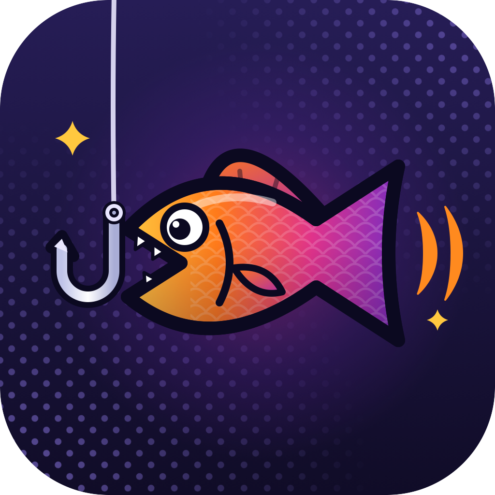

<p align="center"></p>

# MegaBite

<p align="center">
  <a href="https://github.com/megabite-game/megabite/actions/workflows/ci.yml"></a>
  <a href="https://github.com/megabite-game/megabite/releases"></a>
  <a href="LICENSE"></a>
</p>

<p align="center"><b>Fish while Claude works.</b> The game runs in a pane beside the chat, and playing it costs no tokens.</p>

<p align="center"></p>

A small fishing game that lives in a pane beside your Claude Code chat, for the moments you're waiting on Claude. Cast, set the hook, reel in, and build a collection of 50 real fish across five rarity tiers. Your catches are saved on your machine across sessions, and the game flashes (and, if you unmute it, chimes) when Claude finishes.

## Install

At the prompt of a Claude Code terminal session:

```
/plugin install megabite --marketplace megabite-game/megabite
```

Answer `y` to add the marketplace, then pick a scope (Enter takes the user scope, so it loads in every session).

From a shell:

```
claude plugin install megabite --marketplace megabite-game/megabite
```

In the desktop app, where `/plugin` does not run: click + next to the prompt box, then Plugins, Add marketplace with `megabite-game/megabite`, then Add plugin. The game itself plays only in a terminal session; elsewhere the pane says so, and the `/fish` commands still work.

## Play

Type `/fish` to open the game, even while Claude is working. Click the pane once if your keys still go to the chat.

| Key | Does |
| --- | --- |
| Space or Enter | cast (press again to release), set the hook, reel in |
| ← | let line out when the line strains or ↯ flashes |
| Tab | records: Rarest, Heaviest, back to the water |
| m | mute or unmute the chime (muted by default) |
| Esc or q | close (Esc also works from the chat, but only at an empty prompt while Claude is idle: mid-turn, Esc there stops Claude) |

Reeling: keep the ◆ in the green. Too far right snaps the line; too slack and the fish shakes loose. Rarer fish run, head-shake and wear your line.

- **Rarity** shows in the fish's name colour: Common, Uncommon, Rare, Epic, Legendary, based on how often anglers meet the fish in real life.
- **Cast distance** matters: short casts reach near-shore fish, long casts deep-water ones and rarer tiers.
- **Size tags** compare a catch with others of its species: `BIG` is the heaviest 1 in 10, `TROPHY` 1 in 30, `★ RECORD` 1 in 60, the same odds for every fish. Maximum sizes are checked against IGFA and FishBase records.

## Commands

| Command | Shows |
| --- | --- |
| `/fish` | open the game |
| `/fish dex` | your collection by tier, with hints for undiscovered fish |
| `/fish top` | your 10 heaviest catches |
| `/fish rare` | your rarest species, best of each, with size tags |
| `/fish stats` | totals, heaviest, rarest, species found |
| `/fish mute` / `/fish unmute` | the chime when Claude finishes |
| `/fish sound` | whether the chime is muted |
| `/fish help` | keys, rules and tags |
| `/fish close` | close the game |

`/fish dex` after 18 catches:

```
MegaBite dex: 18/50 species
Common 8/15
  Pumpkinseed               1.4 oz   4.6 in   1 caught
  Yellow Perch              2.7 oz   7.7 in   1 caught
  Golden Shiner             8.0 oz  10.2 in   1 caught
  Brown Bullhead            1.5 lb  14.4 in   1 caught
  Channel Catfish           2.6 lb  19.7 in   1 caught
  Smallmouth Bass           1.1 lb  13.1 in   1 caught
  White Sucker              4.9 lb  21.7 in   1 caught
  Atlantic Mackerel         7.7 oz  10.5 in   1 caught
  +7 undiscovered: 4 near shore, 3 anywhere
Uncommon 5/13
  Northern Pike             8.9 lb  31.9 in   1 caught
  Summer Flounder           1.4 lb  15.3 in   1 caught
  Spotted Seatrout          9.8 oz  11.5 in   1 caught
  Lake Trout                3.2 lb  19.9 in   1 caught
  Mahi-mahi                10.1 lb  33.4 in   1 caught
  +8 undiscovered: 4 near shore, 3 anywhere, 1 deep
Rare 2/10
  Tarpon                   65.8 lb  56.5 in   1 caught
  Lake Sturgeon            23.9 lb  44.2 in   1 caught
  +8 undiscovered: 4 anywhere, 4 deep
Epic 3/8
  Blue Marlin             187.3 lb  91.1 in   1 caught
  White Sturgeon          117.1 lb  79.2 in   1 caught
  Giant Trevally           27.4 lb  34.3 in   1 caught
  +5 undiscovered: 1 anywhere, 4 deep
Legendary 0/4
  +4 undiscovered: 1 near shore, 1 anywhere, 2 deep
```

Closing the game adds a one-line recap of the outing to your chat (shown to you only, never sent to Claude).

## FAQ

**Does it cost tokens?** Playing in the pane doesn't. `/fish dex`, `/fish stats` and the other info commands reply in the chat, which counts as a short message to Claude.

**Does it slow Claude down?** No. The game only watches for when Claude starts and finishes a turn.

**Where are my catches saved?** In Claude Code's plugin storage on your machine. Nothing is uploaded.

**How do I remove it?** `/plugin uninstall megabite`, or `claude plugin uninstall megabite` from a shell.

## Develop

```
claude --plugin-dir /path/to/megabite   # run it from this folder
claude plugin test /path/to/megabite    # run the tests
claude plugin validate /path/to/megabite
```

Type checking needs the plugin API's types, which Claude Code writes to `.claude-plugin/types/` (not committed) when it loads the plugin from this folder. Run `claude --plugin-dir .` once, then `npx tsc -p .`.

The demo at the top is drawn by the game's own code: `node scripts/demo/render.mjs` rewrites `docs/demo.svg` (Node 24 or later).

Pull requests are welcome; see [CONTRIBUTING.md](CONTRIBUTING.md).

## License

MIT. See [LICENSE](LICENSE).
